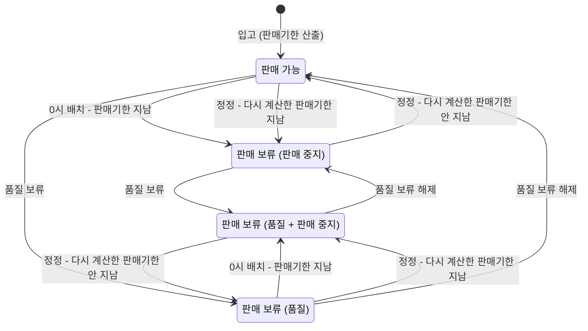

# REQ-011 판매기한 지난 상품 자동 판매 중지 — 요구사항 정리본

| 항목 | 내용 |
|---|---|
| 구분 | 재고 |
| 요청일자 | 2026-08-27 |
| 엑셀 미완료 | N |
| 정리본 상태 | 확정 |
| 최종 수정 | 2026-09-24 (고객 회신 ⑤~⑲ 반영) |

<!-- 이 문서가 원본이다. 요구사항이 바뀌면 이 문서를 먼저 고치고 SPEC(REQ-011-spec.md)을 다시 만든다.
     업무 규칙만 쓴다. 기술 결정(테이블, 클래스, API 경로, 상태 코드값)은 REQ-011-exploration.md에 쓴다. -->

> 실습용 시나리오: ⑤~⑲는 실습을 위해 만든 가상 고객 회신입니다.

## 1. 원문

<!-- 출처: docs/requirements/요구사항정의서_v0.6.xlsx / REQ-011 행. 고치지 않고 옮겼다. 기준은 '최종요구사항'이다. -->

- 요구사항 내용: 상품을 입고 로트별로 판매기한을 관리하고, 판매기한이 지난 로트는 판매되지 않게 막아 주세요. 판매 중지 해제는 MD팀장 결재를 거쳐 하도록 해 주세요. 판매기한이 짧은 로트부터 먼저 출고(선입선출)되게 해 주세요.
- 개발사 검토 사항:
  - ① 09/01 판매기한 기준? → 포장의 소비기한에서 상품별 판매 마감 일수(기본 21일)를 뺀 날. 마감 일수는 MD가 상품별로 설정
  - ② 09/05 선입선출 출고도 범위? → 물류 개편 REQ-019에서 처리
  - ③ 09/12 다른 사유로 보류 중인 로트는? → 판매기한이 지나면 다른 사유와 상관없이 무조건 판매 중지
  - ④ 09/19 해제 결재 연동? → 결재 없음. 판매기한이 지난 로트는 해제하지 않고, 소비기한을 잘못 입력한 경우에만 사유를 남기고 정정
- 최종요구사항:
  - FN1 MD가 상품별 판매 마감 일수를 설정(기본 21일)
  - FN2 입고할 때 입력한 소비기한으로 판매기한(= 소비기한 − 판매 마감 일수) 산출
  - FN3 매일 0시 배치로 판매기한이 지난 로트를 판매 중지(판매기한 당일까지 판매). 다른 사유의 판매 보류와 상관없이 무조건
  - FN4 소비기한을 잘못 입력한 경우 사유와 함께 정정하면 판매기한을 다시 계산. 다시 계산한 판매기한이 지나지 않았으면 판매 중지가 풀리고, 다른 사유의 판매 보류는 그대로
  - FN5 MD가 상품별 판매 가능 재고(판매 보류 로트 제외)를 조회해 판매 중지가 반영됐는지 확인

원문과 최종요구사항이 다른 곳

| 원문 | 최종 | 근거 |
|---|---|---|
| 판매 중지 해제는 MD팀장 결재 | 해제 없음. 소비기한 오입력만 사유와 함께 정정 | ④ 09/19 |
| 판매기한이 짧은 로트부터 출고(선입선출) | 이번 범위 아님 → REQ-019 | ② 09/05 |

## 2. 목적과 범위

- 목적: 온라인 판매는 배송 기간이 있다. 소비기한 직전까지 팔면 고객이 받았을 때 기한이 거의 남지 않는다. 입고 로트마다 판매기한을 정하고, 판매기한이 지난 로트는 매일 자동으로 판매를 중지한다.
- 용어
  - 판매기한 = 소비기한 − 상품별 판매 마감 일수
  - 판매 중지 = 사유가 "판매기한 경과"인 판매 보류. 판매 보류는 사유별로 따로 걸리고 따로 풀린다.
- 포함
  - 상품별 판매 마감 일수 설정
  - 입고할 때 판매기한 산출
  - 매일 0시 판매기한 경과 로트 판매 중지
  - 소비기한 정정과 판매기한 재계산
  - 상품별 판매 가능 재고 조회
  - 배포 전에 입고된 로트의 판매기한 산출
- 제외

| 항목 | 이관처 | 근거 |
|---|---|---|
| 판매기한이 짧은 로트부터 출고(선입선출) | REQ-019 | ② 09/05 |
| 판매 중지 해제 결재(MD팀장) | 하지 않음 | ④ 09/19 |
| 이미 들어온 주문 중 판매 중지 로트에 배정된 주문의 취소·대체 출고 | 하지 않음 (주문 시스템·CS 절차) | ⑪ 09/24 |
| 정정 이력 조회 화면·기능 | 하지 않음 (필요하면 개발사에 조회 요청) | ⑰ 09/24 |

## 3. 확정 규칙

| ID | 규칙 | 근거 | 출처 |
|---|---|---|---|
| R1 | MD가 이 시스템에서 상품별 판매 마감 일수를 1~365일로 설정한다. 설정하지 않은 상품은 21일이다. 상품 관리 시스템에는 이 값이 없다. | 상품마다 유통 특성이 달라 MD가 정한다 | FN1, ①, ⑫, ⑲ |
| R2 | 판매기한 = 소비기한 − 판매 마감 일수. 판매기한 당일까지 팔고, 다음 날 0시에 판매를 중지한다. | 고객이 받았을 때 소비기한이 충분히 남아야 한다 | FN2, FN3, ① |
| R3 | 판매기한은 입고할 때 정한다. 이후 판매 마감 일수를 바꿔도 이미 입고된 로트의 판매기한은 바뀌지 않는다. | 설정 변경 한 번으로 기존 재고가 한꺼번에 판매 중지되는 일을 막는다 | ⑦ |
| R4 | 소비기한이 없는 로트(생활용품 등)는 판매기한이 없고 판매 중지 대상이 아니다. | 판매기한을 계산할 수 없다 | ⑧ |
| R5 | 매일 0시에 판매기한이 지난 로트를 판매 중지한다. 판매 중지는 로트마다 한 번만 건다. | 판매기한이 지난 상품이 팔리지 않게 한다 | FN3 |
| R6 | 입고할 때 이미 판매기한이 지난 로트도 입고 시점에 따로 판매 중지하지 않는다. 다음 0시 배치가 판매 중지한다. | 판매기한이 지난 상품은 물류 입고 검수에서 반려하므로 시스템에 입고되지 않는다 | ⑤ |
| R7 | 판매 중지는 다른 사유의 판매 보류와 상관없이 건다. 다른 사유의 보류는 그대로 남는다. | "무조건" 판매 중지 | FN3, ③ |
| R8 | 판매 중지된 로트는 팔리지 않는다: 판매 가능 재고에서 빠지고, 출고할 수 없고, 제휴몰에서도 판매 불가로 보인다. 제휴몰에는 판매 중지 뒤 다음 재고 연동(최대 30분)에서 반영된다. | 원문 "판매되지 않게", REQ-004 "막아 둔 재고는 제휴몰에서도 팔리면 안 됩니다" | 원문, FN3, REQ-004, ⑱ |
| R9 | 판매 중지에는 해제가 없다. 소비기한을 잘못 입력한 경우에만 물류 담당이 사유와 함께 소비기한을 정정한다. 품질 보류 해제로는 판매 중지가 풀리지 않는다. | 판매기한이 지난 상품을 사람이 판단해 다시 파는 일을 막는다 | FN4, ④, ⑨ |
| R10 | 정정하면 그 상품의 현재 판매 마감 일수로 판매기한을 다시 계산한다. 다시 계산한 판매기한이 지나지 않았으면 판매 중지가 풀리고, 지났으면 판매 중지 상태가 된다(판매 중지가 없던 로트는 즉시 판매 중지). 다른 사유의 보류는 그대로다. | 정정 결과도 판매기한 규칙을 그대로 따른다 | FN4, ⑥, ⑬ |
| R11 | 정정 사유는 반드시 입력한다(공백 불가). 정정 전·후 소비기한과 판매기한, 사유, 처리자, 일시를 이력으로 남긴다. | 정정이 판매 중지를 우회하는 수단으로 쓰이지 않았는지 추적한다 | FN4, ④ |
| R12 | MD가 상품별 판매 가능 재고(판매 가능 로트 수량 합, 판매 보류 로트 제외)를 조회한다. | 판매 중지가 반영됐는지 MD가 직접 확인한다 | FN5 |
| R13 | 배포 전에 입고된 로트도 소비기한이 있으면 배포할 때 판매기한을 정하고(마감 일수 21일), 판매 중지 대상에 넣는다. | 기존 재고도 같은 기준으로 막는다. 첫 0시에 기존 로트가 한꺼번에 판매 중지되는 것을 고객이 수용 | ⑩ |
| R14 | 소비기한이 바뀌지 않는 정정(지금과 같은 날짜로 정정)은 받지 않는다. 소비기한·판매기한·판매 중지가 그대로고 이력도 남지 않는다. | 정정은 잘못 입력한 소비기한을 바로잡을 때만 한다. 마감 일수를 바꾼 뒤 같은 날짜로 정정해 판매 중지를 푸는 일을 막는다 | ⑭ |
| R15 | 소진된 로트도 정정할 수 있다. 소진된 로트에는 판매 중지를 걸지 않는다. | 기록을 바로잡는 목적이고, 팔 재고가 없다 | ⑮ |
| R16 | 소비기한 없이 입고된 로트에 소비기한을 넣는 것도 정정이다. 넣은 뒤에는 R10을 따른다. | 입고 때 소비기한을 빠뜨린 것도 잘못 입력한 것이다 | ⑯ |

## 4. 수용 기준

| AC | Given | When | Then | 유형 | 규칙 |
|---|---|---|---|---|---|
| AC-1 | 판매 마감 일수를 설정한 적 없는 상품 | 소비기한 2026-11-21로 입고하면 | 판매기한은 2026-10-31이다 | 정상 | R1, R2 |
| AC-2 | MD가 판매 마감 일수를 7일로 설정한 상품 | 소비기한 2026-11-21로 입고하면 | 판매기한은 2026-11-14이다 | 정상 | R1 |
| AC-3 | 판매 마감 일수 21일인 상품 | MD가 0일 또는 366일로 설정하면 | 거부되고 21일이 유지된다 | 예외 | R1 |
| AC-4 | MD가 아닌 사용자 | 판매 마감 일수를 설정하면 | 거부된다 | 예외 | R1 |
| AC-5 | 판매기한이 2026-10-31인 판매 가능 로트 | 2026-10-31 0시 배치가 돌면 | 판매 중지되지 않는다 (당일까지 판매) | 정상 | R2, R5 |
| AC-6 | 판매기한이 2026-10-31인 판매 가능 로트 | 2026-11-01 0시 배치가 돌면 | 판매 중지된다 | 정상 | R2, R5 |
| AC-7 | 이미 판매 중지된 로트 | 다음 날 0시 배치가 다시 돌면 | 판매 중지가 중복으로 걸리지 않는다 | 예외 | R5 |
| AC-8 | 마감 일수 21일일 때 입고한 로트 (판매기한 2026-10-31) | MD가 마감 일수를 7일로 바꾸면 | 그 로트의 판매기한은 2026-10-31 그대로다 | 정상 | R3 |
| AC-9 | 소비기한 없이 입고한 로트 | 0시 배치가 돌면 | 판매 중지되지 않는다 | 예외 | R4 |
| AC-10 | 마감 일수 21일인 상품 | 2026-11-01에 소비기한 2026-11-21로 입고하면 | 판매 가능으로 입고되고(판매기한 2026-10-31), 2026-11-02 0시 배치에서 판매 중지된다 | 예외 | R6 |
| AC-11 | 품질 보류 중이고 판매기한이 지난 로트 | 0시 배치가 돌면 | 판매 중지가 추가되고 품질 보류도 그대로 남는다 | 정상 | R7 |
| AC-12 | 판매 중지된 로트 | 출고를 요청하면 | 거부된다 | 예외 | R8 |
| AC-13 | 판매 중지된 로트 (품질 보류가 함께 걸린 로트 포함) | 제휴몰 재고 연동이 돌면 | 제휴몰에 판매 불가 재고로 전달된다 | 정상 | R8 |
| AC-14 | 판매 중지와 품질 보류가 함께 걸린 로트 | 품질 보류를 해제하면 | 판매 중지는 남아 판매 보류 상태가 유지된다 | 예외 | R9 |
| AC-15 | 2026-11-01에 판매 중지된 로트 (마감 일수 21일) | 2026-11-02에 소비기한을 2026-12-31로 정정하면 | 판매기한 2026-12-10, 판매 중지가 풀린다. 2026-11-03 0시 배치에서 다시 중지되지 않는다 | 정상 | R9, R10 |
| AC-16 | 2026-11-01에 판매 중지된 로트 (마감 일수 21일) | 2026-11-02에 소비기한을 2026-11-15로 정정하면 | 판매기한 2026-10-25, 판매 중지가 유지된다 | 예외 | R10 |
| AC-17 | 판매 중지되지 않은 로트 (마감 일수 21일, 판매기한 2026-11-10) | 2026-11-02에 소비기한을 2026-11-20으로 정정하면 | 판매기한 2026-10-30, 즉시 판매 중지된다 | 예외 | R10 |
| AC-18 | 판매 중지와 품질 보류가 함께 걸린 로트 | 정정해서 판매기한이 지나지 않게 되면 | 판매 중지만 풀리고 품질 보류가 남아 판매 보류 상태가 유지된다 | 정상 | R10 |
| AC-19 | 입고 후 마감 일수가 21일에서 7일로 바뀐 상품의 판매 중지 로트 | 2026-11-02에 소비기한을 2026-11-10으로 정정하면 | 현재 마감 일수(7일)로 판매기한 2026-11-03이 되고 판매 중지가 풀린다 | 정상 | R10 |
| AC-20 | 판매 중지된 로트 | 정정 사유 없이(빈 값·공백) 정정하면 | 거부되고 소비기한·판매기한·판매 중지가 그대로다 | 예외 | R11 |
| AC-21 | 소비기한을 정정한 로트 | 정정 이력을 보면 | 정정 전·후 소비기한과 판매기한, 사유, 처리자, 일시가 있다 | 정상 | R11 |
| AC-22 | 물류 담당이 아닌 사용자 | 소비기한을 정정하면 | 거부된다 | 예외 | R9 |
| AC-23 | 판매 가능 40개, 판매 중지 30개, 품질 보류 20개 로트가 있는 상품 | MD가 판매 가능 재고를 조회하면 | 40개다 | 정상 | R8, R12 |
| AC-24 | MD가 아닌 사용자 | 판매 가능 재고를 조회하면 | 거부된다 | 예외 | R12 |
| AC-25 | 배포 전에 소비기한 2026-11-03으로 입고된 로트 | 배포하면 | 판매기한 2026-10-13이 정해지고, 2026-10-14 0시 배치에서 판매 중지된다 | 정상 | R13 |
| AC-26 | 판매 중지된 로트(소비기한 2026-11-21), 입고 후 마감 일수가 21일에서 7일로 바뀐 상품 | 2026-11-02에 소비기한을 같은 날짜(2026-11-21)로 정정하면 | 거부되고 판매기한·판매 중지가 그대로다. 정정 이력도 남지 않는다 | 예외 | R14 |
| AC-27 | 판매기한 2026-11-10인 소진 로트 | 2026-11-02에 소비기한을 2026-11-20으로 정정하면 | 판매기한 2026-10-30으로 바뀌고 정정 이력이 남는다. 판매 중지는 걸리지 않는다 | 예외 | R15 |
| AC-28 | 소비기한 없이 입고된 로트 (마감 일수 21일) | 2026-11-02에 소비기한 2026-11-20을 넣으면 | 판매기한 2026-10-30, 즉시 판매 중지된다. 정정 이력의 정정 전 소비기한·판매기한은 비어 있다 | 예외 | R16, R10 |

## 5. 상태 전이

판매 중지와 품질 보류는 따로 걸리고 따로 풀린다. 보류가 하나라도 남아 있으면 로트는 판매 보류 상태다.

허용되지 않는 전이: S2 → S1 품질 보류 해제(R9), S4 → S3 품질 보류 해제(R9), S2·S4에서 결재 해제(제외 항목)

## 6. 결정 이력

| 날짜 | 결정 | 바뀐 이전 결정 | 이유 | 출처 |
|---|---|---|---|---|
| 09/01 | 판매기한 = 소비기한 − 상품별 판매 마감 일수(기본 21일), MD가 설정 | - | 엑셀에 기록 없음 | ① |
| 09/05 | 선입선출 출고는 REQ-019로 이관 | 원문 "판매기한이 짧은 로트부터 먼저 출고" | 물류 개편에서 출고 로직을 함께 바꿈 | ② |
| 09/12 | 다른 사유로 보류 중인 로트도 판매기한이 지나면 무조건 판매 중지 | - | 엑셀에 기록 없음 | ③ |
| 09/19 | 판매 중지 해제 없음. 소비기한 오입력만 사유와 함께 정정 | 원문 "MD팀장 결재를 거쳐 해제" | 엑셀에 기록 없음 | ④ |
| 09/24 | 고객 회신 ⑤~⑲ 반영 (7절) | - | - | ⑤~⑲ |

## 7. 질문과 미결

<!-- 업무 질문만 쓴다. 기술 질문과 개발 결정은 REQ-011-exploration.md 5절에 쓴다. -->

| # | 질문 | 확인 대상 | 상태 | 답 | 확인일 |
|---|---|---|---|---|---|
| ⑤ | 입고할 때 이미 판매기한이 지난 로트는 어떻게 하나? (입고 거부 / 입고 후 즉시 판매 중지 / 다음 0시 배치에 맡김) | MD팀, 물류팀 | 확인됨 | 판매기한이 지난 상품은 물류 입고 검수에서 반려하므로 시스템에 입고되지 않음. 입고 시점 별도 처리 없이 다음 0시 배치에 맡김 | 09/24 |
| ⑥ | 판매 중지되지 않은 로트를 정정했는데 다시 계산한 판매기한이 이미 지났으면? | MD팀 | 확인됨 | 정정 즉시 판매 중지 | 09/24 |
| ⑦ | 판매 마감 일수를 바꾸면 이미 입고된 로트의 판매기한도 다시 계산하나? | MD팀 | 확인됨 | 다시 계산하지 않음. 이후 입고분부터 적용 | 09/24 |
| ⑧ | 소비기한이 없는 상품(생활용품 등)은? | MD팀 | 확인됨 | 판매기한 없음, 판매 중지 대상 아님 | 09/24 |
| ⑨ | 소비기한 정정은 누가 하나? | 물류팀 | 확인됨 | 물류 담당(입고 담당) | 09/24 |
| ⑩ | 배포 전에 입고된 로트도 대상인가? (배포 직후 첫 0시에 기존 로트가 한꺼번에 판매 중지될 수 있음) | MD팀 | 확인됨 | 대상. 배포할 때 판매기한을 정하고, 첫 0시 일괄 판매 중지 수용 | 09/24 |
| ⑪ | 이미 주문이 들어와 출고를 기다리는 재고가 판매 중지되면 그 주문은? | MD팀, CS팀 | 확인됨 | 이 시스템 범위 아님. 판매 중지 로트에서는 출고하지 않고, 주문 취소·대체 출고는 주문 시스템·CS 절차 | 09/24 |
| ⑫ | 판매 마감 일수의 허용 범위는? | MD팀 | 확인됨 | 1일 이상 365일 이하 | 09/24 |
| ⑬ | 정정할 때 판매기한은 입고 당시 마감 일수로 계산하나, 현재 마감 일수로 계산하나? | MD팀 | 확인됨 | 현재 마감 일수 | 09/24 |
| ⑭ | 소비기한이 바뀌지 않는 정정(지금과 같은 날짜로 정정)도 받나? (마감 일수를 바꾼 뒤 같은 날짜로 정정하면 판매 중지가 풀릴 수 있음) | MD팀, 물류팀 | 확인됨 | 받지 않음. 같은 날짜는 정정이 아님 | 09/24 |
| ⑮ | 소진된 로트도 정정할 수 있나? 판매기한이 지나게 되면 판매 중지를 거나? | 물류팀 | 확인됨 | 정정 가능(기록을 바로잡는 목적). 판매 중지는 걸지 않음 | 09/24 |
| ⑯ | 소비기한 없이 입고된 로트에 소비기한을 넣는 것도 정정으로 하나? | 물류팀 | 확인됨 | 정정으로 처리. 넣은 뒤 판매기한 규칙 적용 | 09/24 |
| ⑰ | 정정 이력을 조회하는 화면·기능이 필요한가? | MD팀, 물류팀 | 확인됨 | 이번 범위 아님. 필요하면 개발사에 조회 요청 | 09/24 |
| ⑱ | 0시에 판매 중지된 로트가 제휴몰에 반영되기까지 다음 재고 연동(최대 30분)이 걸려도 되나? | MD팀 | 확인됨 | 수용. 그 사이 제휴몰 주문은 ⑪ 절차로 처리 | 09/24 |
| ⑲ | 판매 마감 일수는 어느 시스템에서 설정하나? (재고 백오피스 / 상품 관리 시스템) | MD팀 | 확인됨 | 재고 백오피스에서 MD가 설정. 상품 관리 시스템에는 이 값이 없음 | 09/24 |

미결 0건 → SPEC 생성 가능
